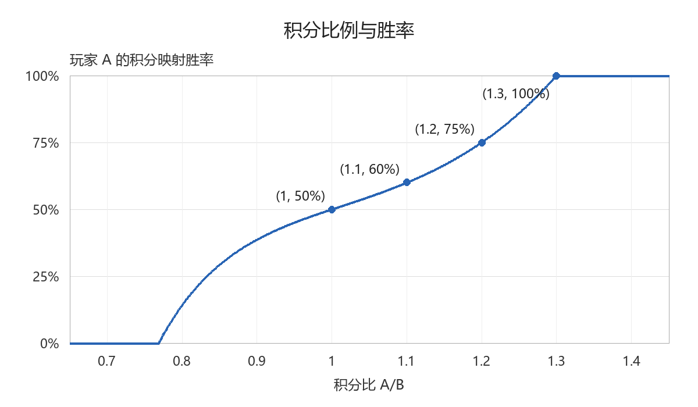

# AoE4 对局复盘

## 第一步：通过 AoE4 解析器读取数据

1. 使用 [AoE4 World 开源解析器](https://github.com/aoe4world/replays-api)读取用户指定的对局摘要；未指定时，从 `Documents/My Games/Age of Empires IV/network` 查找 `M_<对局ID>_*.gz`。根据对局 ID、双方姓名、文明和时长核对目标，不能只按缓存修改时间判断最近一局。
2. 解压 `.gz`，用 `ReplaySummaryParser` 解析、`GameSummaryGenerator` 生成摘要。输入应为文件头为 `Relic Chunky` 的统计摘要；`AOE4_RE` 完整回放不是统计摘要，现有解析器尚未实现其完整命令流解析。
3. 保存解析 JSON 和时间序列，记录输入文件、对局 ID、解析器版本及实际采样间隔。提取胜负、升时代时间、资源、积分、单位创建与损失、击杀价值、遗物等可用数据。
4. **以解析成功、身份匹配且含义明确的解析数据为准。** 截图／OCR 不覆盖这些数据；发生冲突先核对时间、字段含义与版本兼容性。找不到摘要或解析失败时，说明原因及缺失项，再用录像补充。

保留原始采样粒度，不把插值或邻近值当作精确观测。未知字段不解释；实体损失记录不全部等于士兵阵亡，总人口不等于军队人口。

## 第二步：确定对局录像

使用用户指定的双方录像；未指定时，从 Xbox/Windows 录像目录查找并确认，记为 A、B。核对录像中的玩家、文明、时长与解析结果，检查取整和结束转场造成的差异。

## 第三步：对齐游戏时间

1. 截取双方录像的 1、3、5、6、7、8 秒画面，记录游戏时钟与播放／暂停／加载状态。用连续画面的时钟增量确认播放速度和稳定计时区间。
2. 选择双方稳定区间中较晚的游戏时间作为分析起点，分别计算其对应的录像偏移。
3. 在 1 倍速且无暂停／剪辑的区间，录像偏移 = 起点录像偏移 +（目标游戏时间 - 起点游戏时间）；有变速或中断时分段对齐。
4. 结束游戏时间以已核实的摘要为准；视频转场和缺帧单独记录，不用其他时间的画面冒充结束帧。

## 第四步：结合录像分析

1. 每 10 个游戏秒成对取帧，补充结束点。缩略图保持比例并填充至 800×600；文字模糊时查看原始分辨率。
2. 资源、积分、时代和事件时间优先使用解析结果，并保留原始时间戳；10 秒截图不改变摘要的采样频率。
3. 从画面补充解析结果未覆盖的走位、阵型、视野、建造队列、资源农民分配和接战过程。关键窗口再加密检查；“首次看见”不等于事件发生时间，无法确认的项目标为未知。
4. 根据证据解释双方决策及其影响，区分可见事实、机制推断和改进建议。

### 积分映射胜率

使用同一游戏时间双方的解析积分 `S_A, S_B > 0`，按摘要实际采样点计算；缺少解析积分时才用清晰的双方同刻截图并标注来源。零分或无法确认时不计算。

```text
x = (S_A - S_B) / min(S_A, S_B)
P_A = max(0, min(1, 1/2 + 11*x/12 + 25*x^3/3))
P_B = 1 - P_A
```

输出转换为百分比。积分比 1.0、1.1、1.2、≥1.3 分别映射为 50%、60%、75%、100%；交换双方积分，胜率互换。这是指定的积分映射值，不是经过校准的真实获胜概率。



## 第五步：输出总结

Markdown 报告按以下顺序组织：

1. 双方玩家卡片：姓名、文明、胜负。
2. 数据来源：对局 ID、解析状态、采样间隔和缺失项。
3. 上述胜率公式（使用 `text` 代码块）与本局积分映射曲线。
4. 胜者与败者各自做得对的地方、待改进之处。
5. 关键转折点，关联解析记录与截图证据：

|游戏时间|玩家A录像偏移|玩家A画面说明|玩家B录像偏移|玩家B画面说明|积分映射胜率|
|---|---|---|---|---|---|
